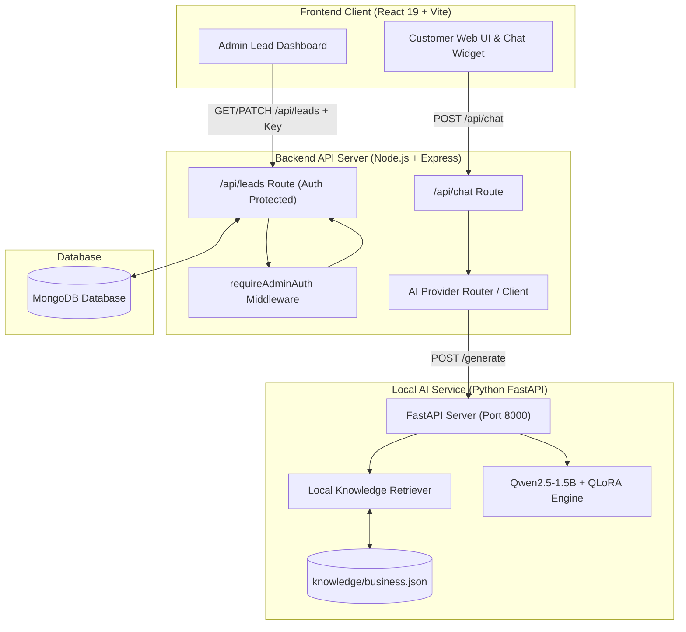

# AI Business Assistant — Full-Stack Customer Assistant & Lead Capture Platform

A production-grade, full-stack AI Customer Assistant and Lead Capture application designed for local businesses (educational institutes, service providers, clinics, agencies). Built with **React 19**, **Vite**, **Node.js / Express**, **MongoDB**, and a local **Python FastAPI LLM Service** powered by fine-tuned **Qwen2.5-1.5B-Instruct** with **QLoRA** and a local RAG (Retrieval-Augmented Generation) pipeline.

---

## 📌 1. Project Overview

**AI Business Assistant** provides an end-to-end automated customer engagement pipeline:
1. **Interactive Customer Web UI**: Embedded responsive AI chat interface where potential customers ask business questions (services, pricing, schedules, locations).
2. **Local Intelligent RAG Engine**: Combines fine-tuned LLM inference with dynamic business knowledge retrieval (`business.json`) to deliver accurate, non-hallucinated answers.
3. **Automated Lead Capture**: Detects intent or accepts manual callback requests, capturing lead contact details into a database.
4. **Admin Management Dashboard**: A secured management dashboard allowing business managers to review leads, analyze intent analytics, and update lead follow-up status in real-time.

---

## ✨ 2. Key Features

- **Local GPU Inference**: Zero third-party API dependencies required; runs locally on consumer GPU hardware (NVIDIA RTX 4050/3060+).
- **RAG & Hallucination Protection**: Enforces similarity confidence thresholds (0.25) and fallback rules so unlisted business information is never fabricated.
- **Multi-Turn Memory**: Remembers context across conversation turns (e.g., active course inquiry, callback prompt context).
- **Lead Capture Integration**: Automatically extracts contact information from chat or manual callback forms and persists leads in MongoDB.
- **Admin Lead Management**: Secured dashboard with status tracking (`New`, `Contacted`, `Converted`, `Lost`), filtering, and analytics metrics.
- **Configurable Business Profile**: Easily customize business details, course catalogs, pricing, facilities, and FAQs without code refactoring.
- **Multi-Layer Security**: Includes API rate limiting, Express 10kb body parsing limits, admin API key authentication, and strict CORS handling.

---

## 🏗️ 3. System Architecture



---

## 💻 4. Technology Stack

- **Frontend**: React 19, Vite 8, Axios, Lucide React, Vanilla CSS.
- **Backend**: Node.js, Express.js, Mongoose (MongoDB ODM), Express Rate Limit, CORS.
- **AI Service**: Python 3.10+, FastAPI, Uvicorn, PyTorch (CUDA), HuggingFace Transformers, PEFT (QLoRA), SentencePiece, Pydantic.
- **AI Model**: `Qwen2.5-1.5B-Instruct` base model with custom fine-tuned QLoRA adapter (`models/business-assistant-lora/`).
- **Database**: MongoDB (Local or MongoDB Atlas).

---

## ⚙️ 5. Prerequisites

Before installing, ensure the following software is installed on your machine:
- **Operating System**: Windows 10/11
- **Node.js**: v18.0.0 or higher
- **Python**: 3.10.x or 3.11.x
- **NVIDIA GPU**: RTX 3050 / 4050 or higher with 6GB+ VRAM (CUDA 12.1 or compatible driver)
- **MongoDB Server**: Local Community Edition running on `mongodb://127.0.0.1:27017` OR a MongoDB Atlas cluster URI.

---

## 🚀 6. Installation Steps (Windows)

### Step 1: Clone Repository & Open Terminal
Open PowerShell or Command Prompt in your workspace directory:
```powershell
cd "c:\Users\prant\Ai Buisness Assistant\AI-Business-Assistant"
```

### Step 2: Install Node Dependencies
Install backend dependencies:
```powershell
cd server
npm install
cd ..
```

Install frontend dependencies:
```powershell
cd client
npm install
cd ..
```

### Step 3: Set Up Python Virtual Environment
Navigate to `ai-service` and create a Python 3.10 virtual environment:
```powershell
cd ai-service
python -m venv .venv
```

Activate the environment:
```powershell
.\.venv\Scripts\Activate.ps1
```

### Step 4: Install Python Dependencies
With `.venv` active, install required Machine Learning packages:
```powershell
pip install -r requirements.txt
```
*(Packages installed: `fastapi`, `uvicorn`, `pydantic`, `peft`, `torch`, `transformers`, `accelerate`, `safetensors`, `sentencepiece`)*

Return to workspace root:
```powershell
cd ..
```

---

## 🗄️ 7. MongoDB Setup

Ensure MongoDB service is running locally on port `27017`:
```powershell
# Verify MongoDB connection via shell or mongosh
mongosh "mongodb://127.0.0.1:27017/ai_business_assistant"
```
*(If using MongoDB Atlas, update `MONGODB_URI` in `server/.env` accordingly).*

---

## 🔐 8. Environment Configuration

1. **Server Environment**: Create or update `server/.env`:
   ```env
   PORT=5000
   MONGODB_URI=mongodb://127.0.0.1:27017/ai_business_assistant
   ADMIN_API_KEY=admin_secret_key_12345
   ALLOWED_ORIGINS=http://localhost:5173,http://127.0.0.1:5173
   LOCAL_AI_SERVICE_URL=http://127.0.0.1:8000/generate
   AI_PROVIDER=local
   NODE_ENV=development
   ```

2. **Client Environment**: Create or update `client/.env` (optional, defaults to `http://localhost:5000/api`):
   ```env
   VITE_API_BASE_URL=http://localhost:5000/api
   ```
   > ⚠️ **SECURITY WARNING**: NEVER put `ADMIN_API_KEY` inside `client/.env` or any `VITE_*` variable.

---

## 🚦 9. Starting the Application Services

Services MUST be started in four separate terminals in the following exact order:

### Terminal 1: MongoDB Service
Ensure MongoDB daemon is running locally:
```powershell
net start MongoDB
```

### Terminal 2: Python FastAPI AI Service (Port 8000)
```powershell
cd AI-Business-Assistant/ai-service
.\.venv\Scripts\python.exe -m uvicorn app.main:app --host 127.0.0.1 --port 8000
```
*(Wait until you see: `[FastAPI Service] Pre-loading local AI model...` and `Application startup complete`)*

### Terminal 3: Express Backend Server (Port 5000)
```powershell
cd AI-Business-Assistant/server
npm run dev
```
*(Wait until you see: `🚀 AI Business Assistant Server running on port 5000`)*

### Terminal 4: React Frontend Client (Port 5173)
```powershell
cd AI-Business-Assistant/client
npm run dev
```

---

## 🌐 10. Accessing Website & Admin Dashboard

- **Customer Website & Chatbot**: Open **[http://localhost:5173](http://localhost:5173)** in your browser.
- **Admin Dashboard**: Open **[http://localhost:5173/admin](http://localhost:5173/admin)** in your browser.
  - When prompted for the **Admin Security Key**, enter: `admin_secret_key_12345` (or your configured `ADMIN_API_KEY`).

---

## 🧪 11. Test Execution Guide

### Verified Executed Tests (All Passed)
1. **Frontend Production Build**:
   ```powershell
   cd client
   npm run build
   ```
   *(Outcome: PASSED cleanly in 1.44s)*

2. **Backend Admin & Security API Suite**:
   ```powershell
   cd server
   node test_admin.js
   ```
   *(Outcome: 6/6 PASSED — Unauthorized checks, lead submission, metrics, status updates, invalid enum checks)*

3. **AI Basic Conversation Test**:
   ```powershell
   cd ai-service
   .\.venv\Scripts\python.exe scripts/test_basic_conversation.py
   ```
   *(Outcome: 20/20 PASSED)*

4. **Vector Knowledge Retrieval Test**:
   ```powershell
   cd ai-service
   .\.venv\Scripts\python.exe scripts/test_retrieval.py
   ```
   *(Outcome: 12/12 PASSED)*

5. **Dynamic Business Configuration Test**:
   ```powershell
   cd ai-service
   .\.venv\Scripts\python.exe scripts/test_business_config.py
   ```
   *(Outcome: 8/8 PASSED)*

6. **Multi-Turn Conversation Test**:
   ```powershell
   cd ai-service
   .\.venv\Scripts\python.exe scripts/test_conversation.py
   ```
   *(Outcome: 6/6 Multi-turn scenarios PASSED)*

7. **Admin & Lead Integration Test**:
   ```powershell
   cd ai-service
   .\.venv\Scripts\python.exe scripts/test_admin_dashboard.py
   ```
   *(Outcome: 3/3 PASSED)*

8. **Full RAG Pipeline Harness**:
   ```powershell
   cd ai-service
   .\.venv\Scripts\python.exe scripts/test_rag_pipeline.py
   ```
   *(Outcome: PASSED — GPU VRAM & execution metrics verified)*

---

## 🎯 12. Customer Demo Checklist

Follow these exact steps during a customer presentation:

1. **Open Customer Website**: Navigate to `http://localhost:5173`.
2. **Ask Basic Greeting / Overview**: Type `"Hello! What is this institute about?"` in the chat window.
3. **Ask Course & Pricing Details**: Type `"What technical courses do you offer and what are the fees?"`.
4. **Ask Follow-Up Query**: Type `"Are online classes available for Python?"`.
5. **Trigger Lead Capture / Callback Request**: Click the **"Request Callback"** button or type `"Can someone call me?"`.
6. **Submit Lead Information**: Enter Name (`Jane Doe`), Phone (`9876543210`), Requirement (`Python Course Inquiry`), and submit.
7. **Verify Database Record**: Open Terminal/mongosh or view MongoDB to confirm lead creation.
8. **Open Admin Dashboard**: Navigate to `http://localhost:5173/admin` and enter key `admin_secret_key_12345`.
9. **Review Leads & Analytics**: Verify lead `Jane Doe` appears at top with status `New`.
10. **Update Lead Status**: Select status dropdown and change from `New` to `Contacted`, then `Converted`. Notice real-time metric counter updates.

---

## 🛠️ 13. Troubleshooting Common Errors

- **Issue**: `ECONNREFUSED 127.0.0.1:8000` in backend logs.
  - **Solution**: The Python FastAPI service is not running. Start Terminal 2 (`uvicorn app.main:app`).
- **Issue**: `HTTP 401 Unauthorized` on Admin Dashboard.
  - **Solution**: Ensure the key entered in the dashboard modal matches `ADMIN_API_KEY` in `server/.env`.
- **Issue**: `CUDA out of memory` during Python startup.
  - **Solution**: Close other GPU-intensive applications or ensure PyTorch is detecting CUDA device properly using `python scripts/check_gpu.py`.
- **Issue**: MongoDB Connection Error (`MongooseServerSelectionError`).
  - **Solution**: Check if local MongoDB service is running via `net start MongoDB` or verify your `MONGODB_URI` string.

---

## 🔒 14. Security Notes

- **Admin Authentication**: Handled via `requireAdminAuth` middleware enforcing `Authorization: Bearer <ADMIN_API_KEY>` or `X-Admin-Key`.
- **Rate Limiting**: Express rate limiters active (`20 req/min` chat limit, `10 req/min` lead limit).
- **Body Parsing Capped**: Express JSON limit hard-capped at `10kb`.
- **Secret Isolation**: `.env` files are ignored in `.git`. `ADMIN_API_KEY` is strictly server-side and never exposed to Vite bundles.

---

## 📋 15. Known Limitations & Production Notes

- **Single-Key Admin Model**: Current admin access relies on a shared API key stored in session memory, suitable for local/private demos. Multi-tenant production requires OAuth2 / JWT login.
- **GPU Requirements**: Local inference requires a dedicated GPU with 6GB+ VRAM. For cloud deployment without a GPU server, switch `AI_PROVIDER=gemini` or `AI_PROVIDER=offline_knowledge`.
- **Detailed Deployment Guide**: Refer to [DEPLOYMENT.md](file:///c:/Users/prant/Ai%20Buisness%20Assistant/AI-Business-Assistant/DEPLOYMENT.md) for hosting recommendations (Vercel, Render, RunPod, MongoDB Atlas).
